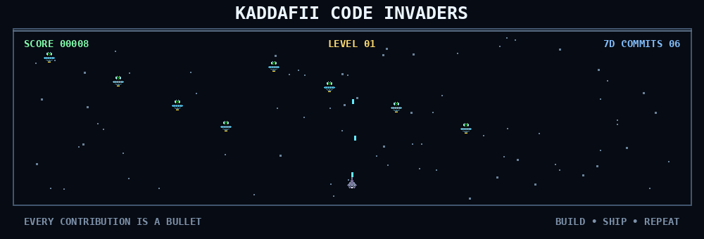

# Hi, I'm Kaddafii 👋

<p align="center">
  
</p>

<p align="center">
  <a href="https://github.com/Kaddafii">
    
  </a>
</p>

---

## 🧑‍💻 About Me

I'm a **Web & Mobile Developer** who enjoys building practical applications and exploring how technology can solve real-world problems.

I have experience developing applications across **web and mobile platforms**, working with backend systems, databases, local development environments, and offline-first applications.

My current interests include:

- 🌐 Web Application Development
- 📱 Mobile Application Development
- 🏗️ Backend & API Development
- 🔄 Offline-First Application Architecture
- 🗄️ Database Design & Management
- 🐳 Containerized Development
- 🤖 Exploring Artificial Intelligence

> **Build something useful. Learn from it. Make it better.**

---

## 🚀 Featured Projects

### 📋 Employee Attendance Web Application

A web-based employee attendance system designed to help manage employee presence and attendance records.

**Technologies**

`CodeIgniter 3` `MySQL`

**Focus**

- Employee attendance management
- Attendance records
- Web-based administration
- Database-driven application

---

### 🦺 K3 Attendance — Web & Mobile

A **web and mobile attendance system for K3 (Occupational Safety and Health)** with an **offline-first approach**.

The application is designed to remain usable even when an internet connection is unavailable, allowing attendance data to be handled locally and synchronized when connectivity becomes available.

**Technologies**

`Laravel` `Flutter` `SQLite` `MySQL`

**Highlights**

- 📱 Mobile application
- 🌐 Web application
- 📴 Offline-first workflow
- 💾 Local data storage
- 🔄 Data synchronization
- 🦺 K3-focused attendance management

> One of my projects that introduced me to the challenges of building applications that need to work reliably in environments with unstable connectivity.

---

### 🏠 KOSAKU

A mobile application for **boarding house / kost rental**, developed as a **PBL (Project-Based Learning) project**.

The application focuses on helping users discover and manage information related to available kost accommodations.

**Technologies**

`Flutter` `SQLite`

**Focus**

- 📱 Mobile application
- 🏠 Kost discovery
- 📋 Accommodation information
- 💾 Local data management
- 🎓 Project-Based Learning

---

## 🛠️ Tech Stack

<p>
  
  
  
  

  
  

  
  

  
  
  

  
  
  
  
</p>

---

<p align="center">
  
</p>

<p align="center">
  <sub>Every contribution is a bullet. Every project is a level.</sub>
</p>

---

## 💡 Philosophy

```java
while (true) {
    learn();
    build();
    experiment();
    solveProblems();
    improve();
}
```

> **Learning is better when it turns into something you can build.**

---

## 🌐 Connect With Me

<p align="center">
  <a href="https://github.com/Kaddafii">        </a> </p>

---

<p align="center">
  <sub>Building software, learning continuously, and turning ideas into reality.</sub>
</p>
