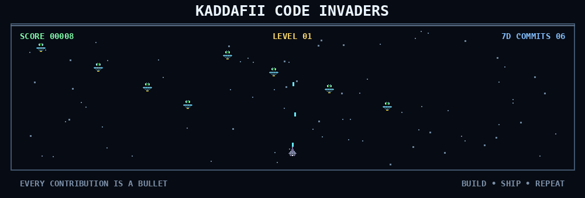

# Kaddafii Code Invaders — Sprite Fix Edition

This version fixes a real bug found by inspecting the sprite pixels directly:
the generator was silently destroying `enemy.png`'s artwork.

## What was wrong

`generate_arcade.py` ran a `remove_near_black_background()` cleanup pass that
turned any near-black *opaque* pixel transparent, on the assumption both
sprites sat on a black background.

Checking the actual files showed that assumption was wrong:

- Both `player.png` and `enemy.png` already ship with a proper transparent
  background (alpha = 0 outside the artwork, confirmed on every edge).
- `enemy.png`'s UFO outline and the alien's face are drawn in **solid black**
  — over 12,000 fully-opaque black pixels that are part of the design, not
  background.

So every run was quietly deleting the UFO's outline and the alien's face
before the sprite was even resized. `player.png` happened to have zero
near-black pixels, so it looked fine — the damage was isolated to the enemy
sprite.

## The fix

- Removed the background-cleanup step entirely. The sprites are used exactly
  as supplied — no pixel data touched, no re-generation, no replacement.
- Added a font-load fallback in the script (`load_font()`), and an explicit
  `fonts-dejavu-core` apt install in the workflow, so a missing font on the
  runner can't crash the whole generation step.
- Left the `mkdir -p arcade-output` ordering as-is — that was already correct
  in the version you sent (directory created before the `gh api` call writes
  `github-data.json`).

I ran the generator locally against both sprites and confirmed the UFO now
renders with its full black outline and alien face intact.

## Sprite size

```text
player.png → 20 × 20 px
enemy.png  → 20 × 20 px
```

Nearest-neighbor scaling only, applied at runtime — no source pixels changed.

## Structure

```text
.github/
├── workflows/
│   └── arcade.yml
└── scripts/
    ├── generate_arcade.py
    └── assets/
        ├── player.png
        └── enemy.png
```

## README

```html
## 🎮 Kaddafii Code Invaders

<p align="center">
  
</p>

<p align="center">
  <sub>Every contribution is a bullet. Every project is a level.</sub>
</p>
```

## Run

1. Replace the old `.github` folder in `Kaddafii/Kaddafii` with this version.
2. Commit and push to `main`.
3. Open `Actions`.
4. Select `Update Kaddafii Code Invaders`.
5. Click `Run workflow` (first run only — see below).

## Does it update automatically after that?

Yes. The workflow keeps its `schedule: cron: "17 0 * * *"` trigger (runs
daily at 00:17 UTC) plus `workflow_dispatch` for manual runs and a `push` to
`main` trigger. You only need to click "Run workflow" once to generate the
first GIF and publish the `output` branch — after that, the daily cron keeps
it in sync with your contribution activity with no action needed from you.

If a scheduled or manual run ever fails with a permission error pushing to
the `output` branch, check **Settings → Actions → General → Workflow
permissions** is set to allow write access — the `permissions: contents:
write` block in the workflow file should cover it, but that repo setting can
override it on some accounts/orgs.

## Dynamic mapping

- Total contributions → SCORE
- Total contributions → LEVEL
- Last 7 days → bullet count
- Last 7 days → player movement
- Recent activity (last 90 days average) → enemy count
